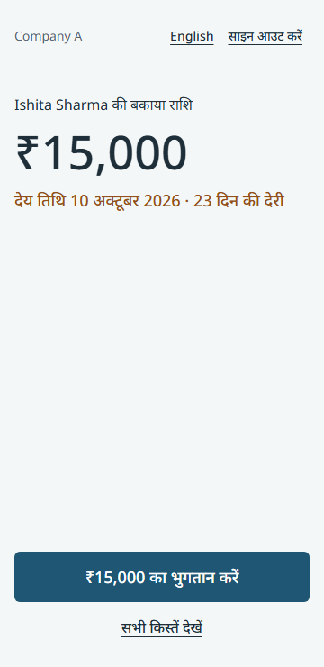
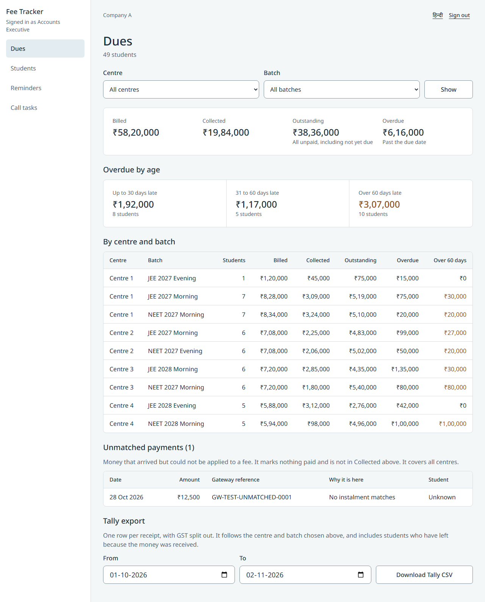
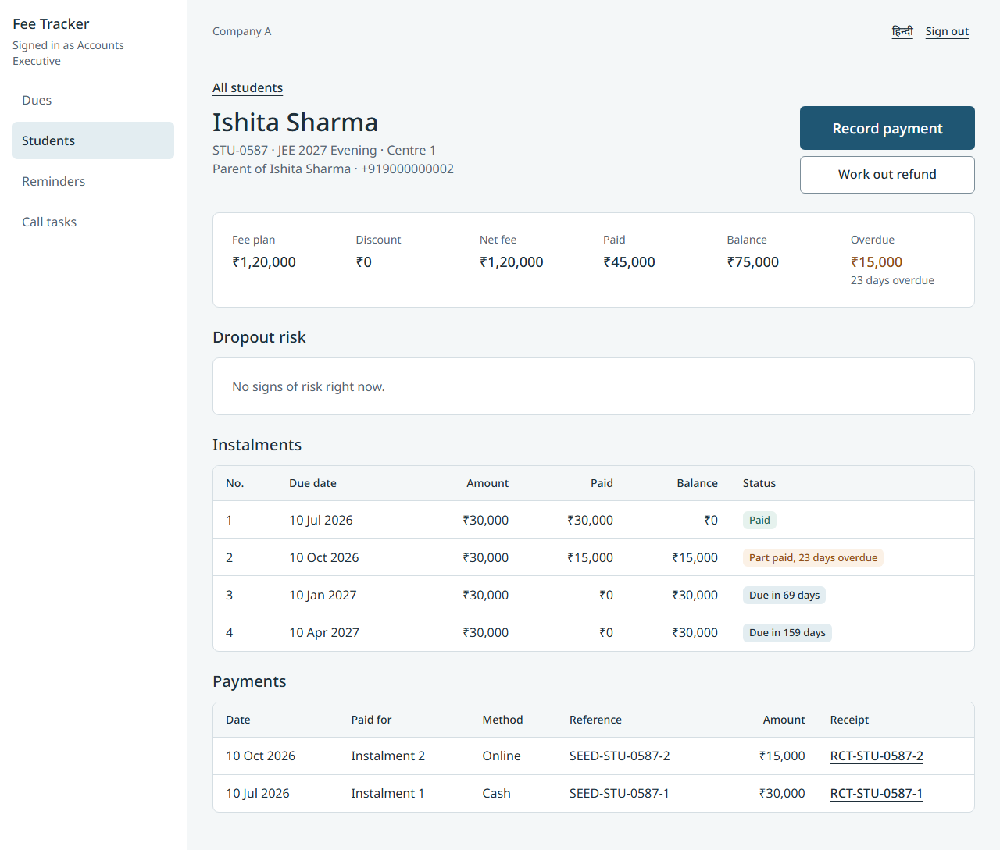
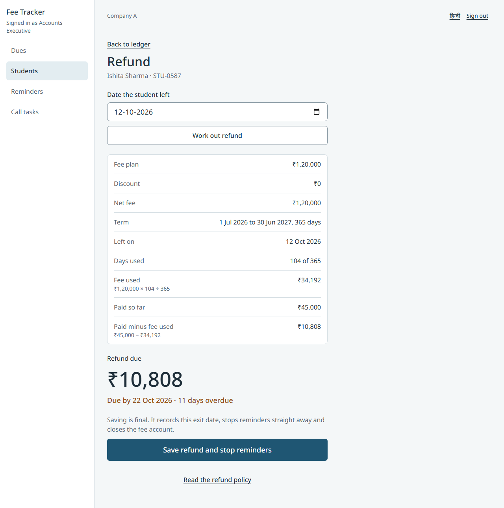
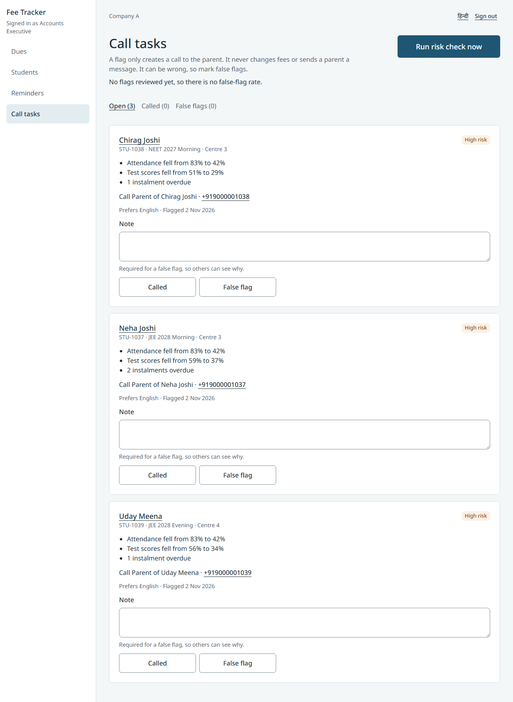

# Fee Tracker

[](https://github.com/Siddhesh-source/coaching_institute/actions/workflows/ci.yml)

A fee portal for Company A, a Jaipur coaching institute with 4 centres and 2,600 students. Parents see what they owe and pay on a phone in seconds, in Hindi or English. Accounts staff get one view of dues across all centres, reminders that stop on payment, and refunds that follow a written rule.

<table>
  <tr>
    <td width="30%"></td>
    <td></td>
  </tr>
</table>

## What it does

**For parents**

- OTP sign-in, with the language chosen first
- Verifiable consent before any student data is shown
- Amount, due date and a pay button, and nothing more
- Attendance and test scores on their own page, away from the home screen
- A test gateway with a signed webhook, and printable receipts showing GST

**For accounts staff**

- Dues by centre and batch, with ageing, the unmatched queue and a Tally export
- A ledger per student with plan, discount, instalments, payments, balance and days overdue
- Reminders in the parent's language, which stop the moment an instalment is paid
- A pro-rata refund calculator with every working line and the 10-day deadline
- Dropout-risk call tasks with plain reasons, false-flag marking and a visible false-flag rate
- Bulk upload of attendance and test scores per batch, with a preview before anything is saved

**What sets it apart**

- **A real data pipeline.** Sample data is replayed day by day through the same code a live day uses, and every run is recorded
- **Reviewer console.** Move the date and watch a term play out: reminders fire, a payment stops them, flags appear
- **Director scoreboard.** The client's own success measures, worked out from the records
- **Refund desk.** Every refund against the 10-day deadline, with second-person approval and a GST credit note
- **Risk lab.** Replays the rule using only what was known each day, and shows who it caught and who it missed
- **Close the books.** Month-end checks against the Tally file, reversals that delete nothing, and an append-only audit log

**Built to fail safely**

- A payment that cannot be matched goes to a queue and marks nothing paid
- A risk flag only ever creates a call task. It has no route to fees or parents
- With too little data, the flag says so and creates no task
- Reminders recheck the balance at the moment of sending
- An upload with one bad row saves nothing, and a repeat upload changes nothing
- A wrong payment is reversed with a new entry, never deleted
- The audit log refuses every update and delete, at the database

## Screens

| Ledger | Refund | Call tasks |
|---|---|---|
|  |  |  |

## Try it

You need Node 22 or later and Postgres.

```
npm install
cp .env.example .env        # then fill it in, see deployment.md
npm run db:migrate
npm run db:seed
npm run dev
```

Open http://localhost:3000. The code appears on screen, because SMS is mocked.

| Number | Who |
|---|---|
| `9000000002` | Parent of Ishita Sharma: part paid, 23 days overdue |
| `9000000003` | Parent of Mohit Gurjar: due in 13 days |
| `9000001035` | Parent of two children |
| `9000000100` | Accounts Executive |
| `9000000101` | Accounts Manager, who approves refunds |

**Try it in 3 minutes:** sign in as `9000000100`, open **Reviewer console**, and follow the guided story.

All people and numbers are fictional. [deployment.md](deployment.md) has the full list, a short tour, and a guide to deploying on the AWS free tier.

## How it is built

Next.js (App Router, TypeScript), Postgres, Drizzle and Tailwind, as one app with one deploy.

```
src/
  app/         routes only: thin pages and server actions
  components/  small shared UI pieces
  domain/      pure business rules, with a test beside each one
  db/          schema, client, sample data, events and replay
  i18n/        English and Hindi text
  lib/         anything that needs cookies or the database
```

- Money is whole paise, and dates are `YYYY-MM-DD` strings
- `lib/payments` is the only code that marks an instalment paid
- Everything from outside enters as an event, and `runDay` is the only daily pipeline
- Role and ownership are checked on every read and write

```
npm test            unit tests
npm run test:db     database tests, on a separate test database
npm run typecheck
npm run lint
```

## Docs

| Document | What is in it |
|---|---|
| [Visual guide](public/guide/index.html) | The whole product in screenshots, with live calculators. Open `/guide/index.html` on the running app |
| [Key decisions](docs/decisions.md) | What was chosen, why, and what was turned down |
| [Mistakes and recovery](docs/mistakes.md) | What went wrong, how it was caught, and what changed |
| [Test guide](docs/demo.md) | Step-by-step missions for trying every workflow, with no technical knowledge needed |
| [Technical design](docs/TDD.md) | Architecture, data model, flows, how the risk flag works, assumptions, limits |
| [Brief check](docs/BRIEF-CHECK.md) | Every brief requirement, its status and where to find it |
| [Deployment](deployment.md) | Local setup, AWS free tier guide, environment variables, demo logins |
| [Design system](DESIGN.md) | Visual rules and the screen plan |
| [Changelog](CHANGELOG.md) | What each release contains |
| [Client brief](docs/brief.txt) | The source of truth |

## Limits

Payments, SMS and Tally are mocked, as the brief allows. The risk thresholds are judgement, tested only on invented data. The full list is in [the design document](docs/TDD.md#12-limits-cuts-and-next-steps).
