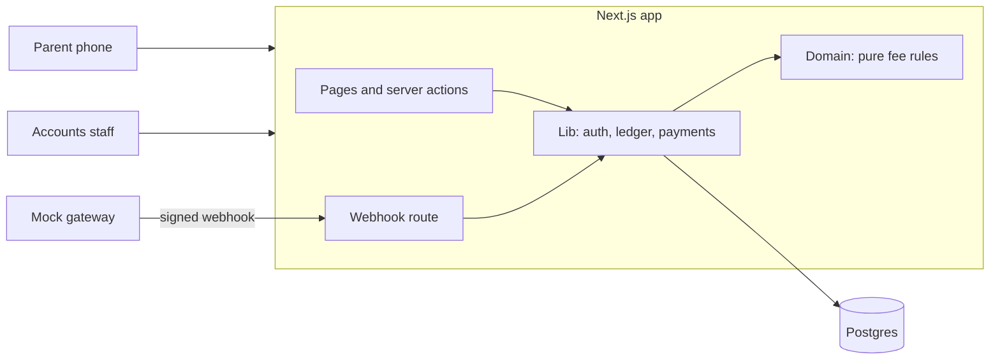
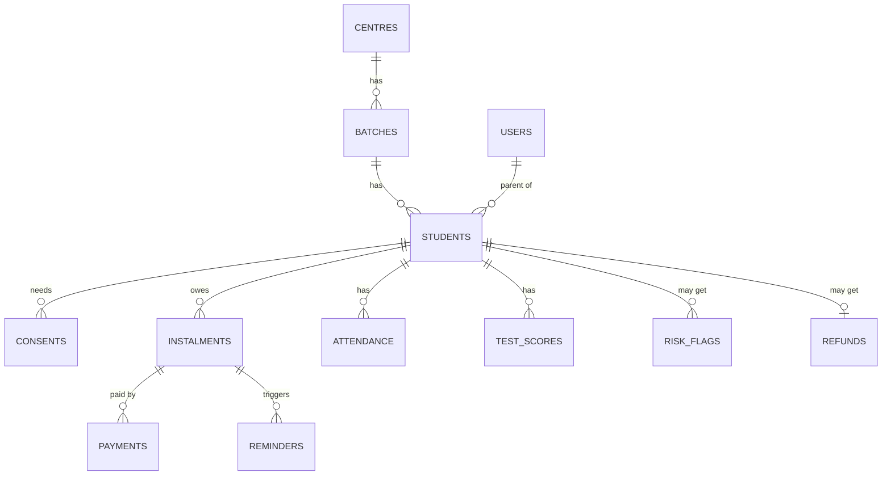
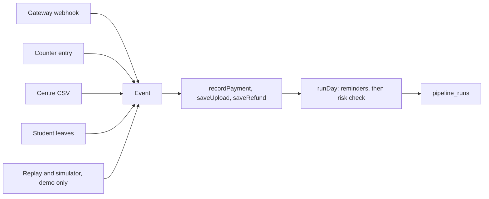
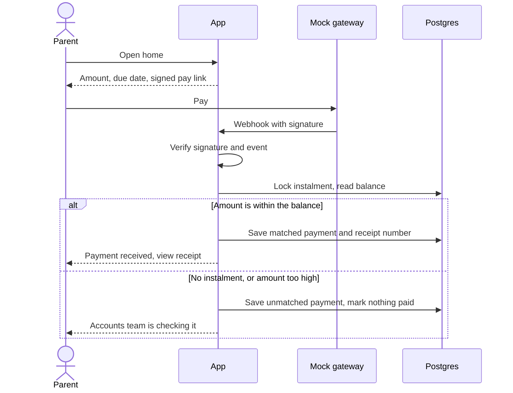
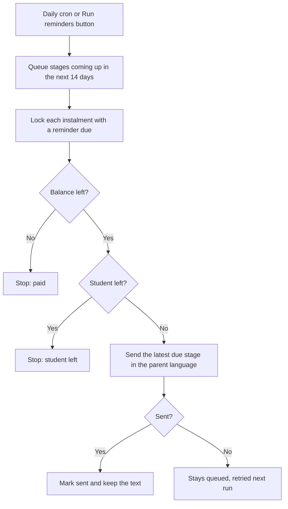

# Fee Tracker: Technical Design Document

**GitHub:** https://github.com/kavyaaa55/CoachingMoneyTracker
**Live app:** not deployed yet (see [deployment.md](../deployment.md))
**Version:** 1.0.0 plus the unreleased changes in the [changelog](../CHANGELOG.md), 6 Nov 2026. The core slice works end to end, with optional depth and a level-up on top. Read with [key decisions](decisions.md), [mistakes and recovery](mistakes.md) and the [visual guide](../public/guide/index.html). [docs/BRIEF-CHECK.md](BRIEF-CHECK.md) lists every requirement.

---

## 1. Summary

Company A runs 4 coaching centres in Jaipur with 2,600 students. Dues live in Excel, staff phone parents, and refunds are worked out by hand. The brief puts the cost at ₹79.2 lakh a year.

Fee Tracker gives parents their dues on a phone in five seconds, in Hindi or English, with a pay button. It gives accounts staff one view of dues, reminders that stop on payment, and refunds that follow a written rule.

| Client success measure | What delivers it |
|---|---|
| Value over 60 days late: 12% to 6% | Automatic reminders, pay link in every message. Measured on the Director Scoreboard |
| Parent calls about dues: down 70% | Parent portal, dues readable in five seconds |
| Month-end reconciliation: 4 days to 1 | Automatic matching, Tally export, month-end checks and a recorded close |

## 2. Brief Against Status

| Brief requirement | Status | Notes |
|---|---|---|
| Sign-in with roles | Built | OTP for parent and accounts roles |
| Verifiable parental consent | Built | Recorded per child, blocks data until given |
| Hindi on parent screens | Built | Language chosen before sign-in |
| Parent dues and pay link | Built | One pay link per instalment, test gateway |
| Payment marks instalment paid | Built | Signed webhook only |
| Unmatched payments never mark paid | Built | Accounts queue. Staff apply from plain-rule suggestions, or return money to the payer |
| Receipts show GST | Built | Printable, Hindi and English |
| Realistic sample data | Built | 60 students, 4 centres, 9 batches, replayed through the real pipeline |
| Pro-rata refund calculator | Built | Every working line, 10 day deadline, refund desk, second-person approval, credit note |
| Published refund policy | Built | Public page in Hindi and English, printable |
| Fee ledger for staff | Built | Search, plan, discount, instalments, payments, balance, days overdue |
| Manual payments | Built | Same matching code as the webhook |
| Reminders that stop on payment | Built | Hindi and English, before, on and after, continuing until paid, with a mock sender |
| Dues dashboard, ageing, Tally export | Built | Filters by centre and batch. CSV of receipts with GST split |
| AI dropout-risk flag | Built | Gemini gives the flag, with rules as fallback. Call tasks only, with false-flag marking and rate |
| Parent attendance and test scores | Built | Optional depth. Own page behind the instalments page, in Hindi and English |
| Bulk upload of attendance and scores | Built | Optional depth. CSV per batch, with a preview and all-or-nothing saving |
| Reviewer console | Built | Level-up. Time machine over the real pipeline, demo mode only |
| Director scoreboard | Built | Level-up. The brief's success measures from the records |
| Risk lab | Built | Level-up. Replays the rule on what was known each day |
| Close the books | Built | Level-up. Month-end checks, reversals, append-only audit log |

## 3. Architecture

One Next.js app holds the pages and the server logic, backed by one Postgres database. Payments, SMS and Tally are mocked as the brief allows.



**Why this shape:** one solo developer, 7 days, and a client who needs something to try. One codebase and one deploy means less to run, secure and explain. A separate API would add a second deploy and duplicated types, and nothing here needs them yet.

**Layers.** Dependencies point one way, from routes down to rules.

| Folder | Job | Rule |
|---|---|---|
| `src/app` | Pages, server actions, webhook | Thin. No business rules |
| `src/lib` | Sessions, ledger queries, payment recording | May use cookies and the database |
| `src/domain` | Fee, refund, OTP and matching rules | Pure functions, no framework or database |
| `src/db` | Schema, seed, sample data | |
| `src/i18n` | All user-facing text | English and Hindi share one type |

The money rules are the hard part of this brief, so they sit in `src/domain` where a test can run them in milliseconds.

| Part | Choice | Why |
|---|---|---|
| App | Next.js 16, React 19, TypeScript | Pages and server in one deploy |
| Database | Postgres 18 | Constraints and row locks protect money records |
| Queries | Drizzle | Plain SQL feel, typed, versioned migrations |
| Styling | Tailwind 4 | Design tokens live in one file |
| Validation | Zod | Checks outside data at the server boundary |
| Tests | Vitest | Unit tests, plus database tests on real Postgres |

**Capacity.** Measured at Company A's real size, 2,600 students: dashboards take 10 to 150 ms, and the daily pipeline about 5 seconds. [operations.md](operations.md) has the figures, monitoring, backups and the scaling path.

## 4. Key Decisions

The core choices are below. The level-up and data pipeline choices are in [decisions.md](decisions.md).

| Decision | Why | Rejected |
|---|---|---|
| Store money as whole paise | Sums never drift. Rounding happens once, on purpose | Decimals or floats |
| Dates as `YYYY-MM-DD` strings | A due date has no time zone, so it cannot shift by a day | Date objects |
| Paid amount is calculated from payments | One source of truth. Balance can never disagree with history | A stored `paid` column |
| One file changes payments | `lib/payments` is the single place to audit | Updates spread across routes |
| Manual entry uses the same `recordPayment` | One matching rule for all money. A mismatch is refused inside the same lock, so it cannot race | A separate staff write path |
| Stop reminders in two places | The payment cancels queued reminders in the same step, and the job rechecks the balance at send time | Checking only when scheduling |
| Job and payments share one lock | A payment cannot slip in during a send, and two runs cannot send twice | A separate job lock |
| Only a signed webhook can record a gateway payment | The browser is never trusted to say it paid | Marking paid on the redirect |
| `gateway_ref` is unique | A repeated webhook changes nothing | Checking in code alone |
| Lock the instalment row while matching | Two payments cannot both use the same balance | Hoping they never collide |
| Database refuses an applied payment with no instalment | The rule holds even if the code has a bug | Code checks alone |
| Fixed demo date, `APP_TODAY=2026-11-02` | The brief's "23 days overdue" and "Due in 13 days" both point to this date | Real date, which would make the sample wrong |
| Pay links signed and free of student data | Safe to send in a message to a minor's family | Links needing sign-in |
| Role read from the database per request | A role change applies at once | Role stored in the cookie |
| Separate database for tests | Tests can wipe tables without touching demo data | Sharing one database |

## 5. Data Model

17 tables, 17 migrations. The core of it:



`otp_codes` stands alone, keyed by phone number. `pipeline_runs`, `audit_events` and `month_closes` are records of what happened, and nothing reads them to decide a fee.

Bulk upload needed no new table or migration. The existing unique keys, one attendance row per student and week and one score per student and test, are what make a repeat upload safe.

Rules the database itself enforces:

- `payments.gateway_ref` and `receipt_no` are unique.
- A payment has an instalment only if it is `matched` or `reversed`.
- Amounts must be positive, discounts cannot exceed the plan, and attendance and scores stay in range.
- A student can have only one refund, and a reminder stage can exist only once per instalment.
- A student has one attendance record per week and one score per test.
- `risk_flags` has no link to fees or messages, so the flag has no route to a fee action.
- The person who saved a refund cannot approve it.
- `audit_events` refuses every update and delete, through a trigger.
- A month can be closed only once.

## 6. Main Flows

### Data pipeline

The demo and production share one path. Only the source of events differs.



- **Sources.** Live, these are the webhook, the counter form, the upload screen and staff actions. In the demo, `src/db/sample-events.ts` turns the sample into the events that would have produced it, and `src/lib/simulator.ts` makes future ones.
- **One day.** `runDay` takes in what arrived, then runs reminders and the risk check. Cron, the staff buttons, the replay and the time machine all use it.
- **Failure.** A failed stage is recorded and the next still runs. The daily route returns 500 so the scheduler can alert.
- **Replay.** Enrolment is inserted directly, because admissions are out of scope. The term then replays from 25 Jun to 2 Nov in about 15 seconds. The demo date's jobs are left to run, so reminders are waiting when a reviewer arrives.
- **Result.** 130 recorded days, 81 receipts from one series, 475 reminders sent and 189 stopped, none written by hand.

### Close the books

A person applies queued money from plain-rule suggestions, or returns it to the payer with a note. A wrong payment is reversed, never deleted: the receipt shows as cancelled, a Reversal voucher goes to Tally on that day, and future reminders restart. Month end adds up the finished Tally file against the ledger. A month closes once it is over, the totals agree, nothing is queued and receipts have no gaps. A closed month refuses backdated payments.

### Refund desk

Saving a refund is unchanged and final. It then waits for a second accounts user, a rule the database also enforces. Paying records the date and reference and issues a credit note with GST split, which reaches the Tally export. A ₹0 refund skips these steps. Parents see the status.

### Sign-in and consent

1. The parent picks a language, then enters a mobile number.
2. An OTP is created and stored only as a hash. In demo mode it appears on screen, because SMS is mocked.
3. Unknown numbers get the same response, so the form cannot reveal who is registered.
4. The right code starts a signed, httpOnly session cookie.
5. Parents see the consent notice once. No student data loads until consent exists for every child.

### Payment



A double click sends the same reference, so the second one changes nothing. Tests prove this with six identical events arriving at once.

### Manual payment

Accounts staff record cash, UPI, cheque and bank payments from the student's ledger.

1. Staff pick the instalment, then enter the amount, method, reference and date.
2. The server checks the role, the input, and that the instalment belongs to this student.
3. `recordPayment` applies the same matching as the webhook.
4. Gateway money that does not match has really arrived, so it is queued. A manual entry that does not match is a typing mistake, so it is refused and nothing is saved.
5. Each payment stores the method, the reference and who entered it. The parent's balance updates at once.

### Refund

```
fee used = net fee x days used / term days     (both end dates count, rounded to the rupee)
refund   = amount paid - fee used              (never below zero)
due by   = exit date + 10 days
```

**Worked example:** Ishita Sharma, ₹1,20,000 plan, ₹45,000 paid, leaves 12 Oct 2026.
Fee used is ₹1,20,000 × 104 ÷ 365 = ₹34,192. Refund is **₹10,808**, due by 22 Oct 2026.

Tests also cover discounts, exit before term, exit after term, and a parent who paid less than the fee used.

**Screen.** Staff open it from the ledger and pick an exit date. The server shows every working line, the result and the deadline. A future date is a preview only, so the exit-after-term case can be checked before it happens.

**Saving** runs in one transaction:

1. Lock the student's instalments, the same lock `recordPayment` and the reminder job take. A payment in progress finishes first and is counted.
2. Work out the amount again from the database. Nothing about the amount comes from the form.
3. Store the refund with the net fee and amount paid, so the working stays true later.
4. Set the exit date and stop every queued reminder with the reason `student-left`.

**After saving,** the fee account is closed, because a later payment would make the saved refund wrong. Parents see the refund and no pay buttons. Old pay links stop working. Gateway money that still arrives goes to the unmatched queue, and manual payments are refused. The policy lives at `/refund-policy`, with no sign-in, and its example is worked through the real rule.

### Dues dashboard and Tally export

Staff land here after sign-in. Every figure is worked out on each page load from instalments and matched payments, by pure functions in `src/domain/dues.ts`. Nothing is stored or typed in.

| Figure | Meaning |
|---|---|
| Billed | Every instalment for the term |
| Collected | Matched payments only |
| Outstanding | All unpaid, including instalments not yet due |
| Overdue | The part of outstanding past its due date |
| Ageing | Overdue split by days late: up to 30, 31 to 60, over 60 |

Billed always equals collected plus outstanding, and the buckets always add up to overdue. Tests hold both true. A student with two late instalments can appear in two buckets, so bucket student counts can add up to more than the number of students.

Students who have left are not counted, because their fee account is closed. The page says how many were left out. The batch filter works by name, because the same batch name runs at several centres. The table keeps one row per batch at each centre.

**Tally export (assumed format).** The brief names no format, and Tally has no single standard CSV, so these columns are a proposal to map in Company A's import tool. It needs checking against their Tally setup before real use.

| Column | Example | Notes |
|---|---|---|
| Voucher Date | 05-10-2026 | Day first |
| Voucher Type | Receipt | Always Receipt |
| Voucher Number | RCT-000123 | The receipt number |
| Centre, Batch | Centre 1, JEE 2027 Evening | |
| Student ID | STU-0587 | No student name, because the ID is enough and most students are minors |
| Narration | Instalment 2, STU-0587 | |
| Debit Ledger | Bank | Cash for cash, Bank for everything else |
| Reference | UPI123 | Staff reference, or the gateway reference |
| Course Fee, CGST, SGST | 12711.86, 1144.07, 1144.07 | The fee before tax and the 9% + 9% split |
| Total | 15000.00 | The three parts always add up to this |

**Unmatched queue.** The Dues page lists money that arrived but could not be applied, with the reason and the student it was meant for when known. It is read only. Applying a payment by hand needs a reversal trail, so it comes with that work.

The file holds matched receipts in the chosen dates, within the chosen centre and batch. It includes students who have since left, because that money was received. Unmatched payments stay out until staff resolve them. Text that could run as a spreadsheet formula is made safe, since staff type the reference. The route checks the role and the dates first.

### Reminders



- **Stages:** 7 and 1 days before, on the due date, and 3 days after. Then weekly from day 7 to day 63, and every 4 weeks after that for up to a year.
- **Why they continue:** the client asked for reminders to stop when someone pays, not after a set time. The brief blames late and uneven follow-up for ₹62.4 lakh a year, and its measure is value over 60 days late, so going quiet after a week would leave that window to staff. The pace slows after 9 weeks so a parent never feels chased.
- **Stopping:** a full payment stops queued reminders in the same database step. The job also rechecks the balance at send time.
- **Part payments:** reminders continue, for the amount still left.
- **Missed days:** only the latest stage goes out, and older ones are marked replaced.
- **Failures:** a failed send stays queued and is retried on the next run.
- **Trigger:** a daily route protected by a secret, or the staff button. Both run the same job.

### Bulk upload

The risk flag reads attendance and test scores, so without this the flag could never change after the sample data was loaded.

1. Staff choose a batch and a kind, and can download a template listing that batch's current students.
2. The server reads the CSV and checks every row against that batch. It writes nothing at this step.
3. If any row is wrong, every problem is listed by line and nothing can be saved.
4. If the file passes, a preview marks each row new, changed or already saved, and shows the old value of anything changed.
5. Saving reads and checks the file again, because the preview proves nothing. One statement saves every row or none.

**Checks.** Student in this batch, no repeats in the file, real dates, nothing in the future, before term or after the student left, a Monday for week start, whole numbers in range, present within total and score within maximum.

**What it reads.** Excel's byte order mark, Windows line ends, quoted cells, columns in any order and day-first dates, since Excel rewrites dates when it saves.

**When it is wrong.** A repeat upload finds nothing to do. A correction replaces the saved value. Uploading writes only attendance and test scores, and a test confirms instalments, payments, reminders and call tasks do not change. It does not run the risk check, so a half-finished batch cannot create call tasks. The next daily run or the staff button picks it up.

### Parent attendance and test scores

A separate page reached from the instalments page. It shows classes attended in the last 4 weeks, then the latest 12 weeks and 12 tests. It goes through the same consent and ownership check as every parent page, and shows plain figures only. Nothing on it refers to risk.

## 7. AI and Automation

| Automation | Status | When it is wrong or unsure |
|---|---|---|
| Payment matching | Built | Unmatched payments go to a queue and mark nothing paid |
| Reminders | Built | Balance rechecked at send time. Failed sends are retried |
| Dropout-risk flag | Built | Creates a call task only. Counsellors mark false flags. Too little data creates no task. The Risk Lab tests the rule |

**Dropout-risk flag.** Gemini gives the flag, and the rule below is its fallback. It runs daily from a protected route or a staff button, and reads missed instalments, attendance and test scores.

- **Method:** one call per run sends Gemini each student with a sign, under a made-up id, as percentages and an overdue count. It returns a band, a confidence and a reason. The transparent points in `src/domain/risk.ts`, measured against a learned batch baseline, decide when it cannot. This is a general model judging records, not one trained on dropouts, because no such history exists.
- **Attendance:** the last 4 weeks against earlier weeks. A fall of 15 points scores 1, and 30 points scores 2.
- **Tests:** the last 2 tests against earlier tests. A fall of 10 points scores 1, and 20 points scores 2.
- **Missed instalments:** 1 overdue scores 1, and 2 or more scores 2.
- **Bands:** 2 points is watch and 4 is high, but only with an attendance or test sign. Late fees alone never flag anyone, however many, because reminders handle money and being short of money is not a sign of leaving.
- **Output:** a band with plain reasons, such as "Attendance fell from 83% to 42%". Never a score like 72/100, because a precise number would overstate what the data can show. Reasons are stored as facts and worded on screen in either language.
- **Unsure:** under 6 weeks of attendance, under 4 tests, or no fee plan gives "not enough data". The ledger says so and no task is created.

**When it is wrong.** The job writes to one table, `risk_flags`, which has no link to fees or messages. A test takes a full copy of instalments, payments, reminders, refunds, students, consents and users, runs the job and a review, and confirms nothing changed. Parents never see a flag. Counsellors mark each task "called" or "false flag", a false flag needs a note, and the screen shows the false-flag rate from real reviews. The rate is shown rather than fed back automatically, so a person decides when to change the thresholds.

**AI layer.** It sits inside the existing screens, and `src/domain/ai.ts` decides what goes in and comes out.

| Part | What it does | When it is wrong or unsure |
|---|---|---|
| The flag | Gemini gives the band for each student with a sign, and can add or clear a flag | Low confidence, a failure or no key means the rule decides, and the task says so. Too little data is never sent, late fees alone cannot flag, and figures come from our records |
| Batch baseline | Learns each batch's typical fall, by median, and counts only a student's fall beyond it | Under 3 students, it learns nothing and the plain rule applies |
| Learning from outcomes | Risk Lab tries about 150 sets of numbers against the term, scored on leavers caught and false flags | Under 3 cases it says so. It only proposes, and a person decides |
| Call guide | Gemini drafts a guide in the parent's language | A draft mentioning money, or with links, numbers or placeholders, is replaced by the template |
| Payer note | Gemini reads free text such as "doosri kist", and code matches it to real students | Hints only narrow a suggestion. Money stays unmatched until a person applies it |

Gemini never sees a name, ID, phone number or amount. The flag gets a made-up id, percentages and an overdue count, notes are masked first, and call guides get no fee reason at all. Calls have a time limit, and with no key or a failure every step falls back to plain rules. Output is labelled as AI, and each task shows who decided and what the rule alone said. Its writes are limited to the call task, the note hints and the log, so it has no route to fees or parents.

On the sample, Gemini agreed with the rule on three students, raised Pranav Saini from watch to high because his records stopped, and flagged Manav Bairwa, whom the rule passed. Replays stay offline, so the final demo day is judged live, and the Risk Lab tests the fallback rule, not Gemini.

**Records that stop.** A student two weeks behind the latest attendance in the batch scores 2 points, as the strongest attendance sign. Comparing with the batch stops a late file from flagging a whole class. Each flag stores its rule version.

**Risk Lab.** Replays the rule on every Monday of the term, using only what was known that day, and shows who was flagged, how early, and who was missed. On the sample it flags 4 of 6 leavers, with an average of 21 days' warning, and misses 2. What-if numbers change nothing live, and "late fees alone never flag" cannot be adjusted.

**Repeat flags.** A student has at most one open task, enforced by a database index, and the job refreshes its reasons as data changes. After a review the job leaves that student alone for 30 days. Students who have left are skipped, and their open tasks drop off the list.

The thresholds were set by judgement against sample data I wrote myself, so these figures show the tool works, not that the rule predicts dropouts. Run daily, the rule leaves five open tasks on the demo date: the three students built to trigger it, Uday Vyas, whose attendance dipped, and Pranav Saini, whose records stopped. It says Manav has too little data, and leaves Ishita alone despite her late fee.

## 8. Security and Compliance

The app was attacked live with 65 checks. 10 failed at first, and all pass now. [security.md](security.md) lists what held, what broke and what is still accepted.

| Requirement | How it is met |
|---|---|
| No secrets in the repo | `.env` is ignored by git. Only variable names are committed |
| Input validation | All checked on the server: Zod for webhook and gateway data, domain rules for phone numbers and OTP codes |
| Access control | `requireUser` and `requireParent` guard protected pages and actions. Parents cannot open staff pages |
| Parent isolation | Queries filter by owner. Another family's receipt returns "not found" |
| OTP abuse | Hashed, 5 minute expiry, 5 tries per code, 5 codes per 10 minutes |
| Parallel guessing | Attempts are counted in one statement. 12 parallel guesses stopped at exactly 5 |
| Session theft | httpOnly, SameSite=Lax, secure in production, signed, 7 day limit |
| Scheduled jobs | The reminders and risk routes refuse any call without the secret |
| Forged webhooks | Signature checked in constant time. Changed bodies are refused |
| Token reuse | Session and pay link tokens use separate signing keys |
| DPDP Act 2023 | Consent recorded per child with a notice version. A new version asks again |
| Coaching guidelines 2024 | Refund rule, 10 day deadline and published policy page built |
| GST on receipts | Taxable value, CGST and SGST shown. The parts always add up to the total |

## 9. UI and Design Decisions

The client asked for minimal design and that parents understand dues in five seconds. The direction is **trust and calm**. Full rules are in [DESIGN.md](../DESIGN.md).

| Screen or choice | Why it looks this way |
|---|---|
| Parent home | Only the name, amount, due date, pay button and one link. The test is five seconds |
| Pay button at the bottom | Within thumb reach on a phone |
| Overdue in amber, not red | It is a fact, not an emergency. Red is kept for real failures |
| Noto Sans | Has Hindi, the ₹ sign and equal-width digits, and is familiar on Android |
| One blue | If it is blue, it can be pressed |
| Language before sign-in | A Hindi reader should never have to read English to begin |
| Status always in words | Colour alone fails for some readers |
| Flat, no shadows | Light on low-end phones, and nothing without a purpose |
| Attendance and scores behind instalments | Parent home stays at one link, so the five-second test still holds |
| Upload preview before saving | Staff see old and new values, because a wrong file affects what parents read |

Fonts were tested, not assumed. Inter has no Hindi. Hind and Martel have uneven digits, which breaks ledger columns. Palanquin lacks the ₹ sign. All text passes contrast at 5.5:1 or better, up from 1.99:1 in the first mockups.

The 31 mockups are kept in `docs/mockups` as layout reference only. They contained invented claims and sample numbers that disagreed, listed in DESIGN.md.

## 10. Testing

436 tests pass, and CI runs lint, types, tests and a build on every push.

| Suite | Tests | Covers |
|---|---|---|
| Unit | 243 | Fee, refund, exit dates, OTP, GST, matching, ledger totals, reminder rules, dues and ageing, Tally format, risk bands and missing data, replay and look-ahead, batch baseline, learned thresholds, AI guardrails, late share, suggestions, sessions, sample data, language files |
| Database | 193 | The whole replayed term, AI drafts and fallbacks with the network faked, time machine, refund approval and credit notes, reversals, queue, month close, audit trigger, uploads, races, part payments, reminder stages and stopping, and that the flag changes nothing else |

Tests use the brief's own rows, so Aarav, Ishita and Mohit must produce exactly the brief's statuses. Main flows were also walked through in a real browser at 360px, in both languages.

A polish check then visited every screen at 360px in both languages, 67 views in all, measuring overflow, tap targets, field labels, headings and dead links. It also tried to reach another parent's child by changing the address, and looked for secrets in the full git history. Nothing leaked and no secrets were found.

Testing found real problems, listed with their fixes in [mistakes.md](mistakes.md). The worst, such as a queued payment being offered to strangers, passed every test and were found by using the screens.

## 11. Assumptions

The brief does not state these. Each one is my judgement.

| Topic | Assumption | Reason |
|---|---|---|
| Refund formula | Pure pro-rata by days, as in section 6 | The brief requires pro-rata but gives no written policy |
| Retained fee | None, confirmed by the owner | The brief mentions no registration fee |
| Refund saving | A future exit date is preview only. Saving is final, one per student, and keeps the figures used | Saving stops reminders, so it must mean the student has left |
| After a refund is saved | The fee account closes. Late gateway money is queued and manual payments are refused | A later payment would make the saved refund wrong |
| Unpaid fee used | Shown to staff, never collected automatically | The brief covers refunds, not recovering money from leavers |
| Refund deadline | Counts from the exit date, even if saved late | The brief says within 10 days of the student leaving |
| Academic term | 1 Jul 2026 to 30 Jun 2027 | No dates given. Instalments run to April |
| Instalment plans | ₹1,20,000 as 4 × ₹30,000 or 3 × ₹40,000 | Fits the brief's average fee and sample rows |
| Batch schedules | Due dates per programme, plus JEE 2028 and NEET 2028 | Only three due dates given |
| Part payments | Up to the balance is applied. More goes to the queue | The brief bars wrong amounts but its sample has part payments |
| Manual payments | Must fit the balance or are refused. Dates cannot be in the future | A typing mistake is not money that arrived |
| Parent home amount | Oldest unpaid instalment, other overdue amounts on one line | Pay links are per instalment |
| GST | 18% inside the fee, 9% CGST and 9% SGST, sample GSTIN | No rate or number given |
| Reminder schedule | 7 and 1 before, on the day, 3 after, weekly from day 7 to 63, then every 4 weeks up to a year, until paid | The brief says before, on and after, and to stop on payment. Its 60 day measure needs follow-up past 60 days |
| Reminder delivery | Sent to the registered number whether or not the parent has used the portal, with the student's name | Reminders are the service itself, and a parent of two needs to know which child |
| Missed job days | Only the latest due stage goes out | A parent should not get several messages at once |
| Individual due dates | 6 sample students have their own due dates | So every stage falls on the fixed demo date |
| Ageing buckets | 0–30, 31–60, 60+ days | The success measure uses 60 days |
| Dues figures | Defined in section 6. Students who have left are not counted | The brief does not define them, and a closed account is not collectable |
| Tally export | One row per matched receipt, columns as in section 6 | The brief names no format |
| OTP delivery | SMS is mocked. In demo mode the code shows on screen | The brief says to mock messages |
| OTP limits | 5 minutes, 5 tries, 5 codes per 10 minutes | Not specified |
| Consent proof | OTP on the registered number, plus a stored record | Method not specified |
| Centre names | Centre 1 to Centre 4 | Not named |
| Counsellor | The accounts role handles call tasks | Only two roles in the core build |
| Risk method and thresholds | Points as in section 7 | No real dropout history to train on |
| Late fees alone | Never flag a student | Reminders handle money, and it is not a sign of leaving |
| Too little data | Under 6 weeks of attendance, under 4 tests, or no fee plan | The brief does not say how much is enough |
| Repeat flags | One open task per student, then 30 days after a review | A counsellor should not be asked again the next morning |
| False flag note | Required | The reason helps tune the rule |
| Unmatched queue | Staff apply from plain-rule suggestions, or return to the payer | The brief requires the queue. A common amount is not evidence |
| Records that stop | Two weeks behind the batch scores 2 points | A vanished student is the likeliest dropout |
| Refund approval | A second accounts user, no new role | The brief names two roles |
| Credit notes | Issued on paying a refund, sent to Tally | The brief covers receipts only. An accountant must confirm |
| Reversals | Marked reversed, never deleted, with a Reversal voucher | Money is corrected with a new entry |
| Month close | Once over, totals agree, nothing queued, no receipt gaps | The brief measures the time, not the method |
| Late share | Per rupee, instalments due 60 or more days ago, unpaid counts as late | The brief does not define it |
| Parent call measure | Shown as not tracked | The app has no call data |
| Time machine | Demo only, forward only, in memory, shared by all viewers | Otherwise weeks of behaviour cannot be reviewed |
| Batch baseline | Median fall in a batch of at least 3 is taken off each student's fall | A shared dip is not a sign of leaving |
| Who gives the flag | Gemini, with the rule as fallback, and code holds the hard lines | The brief says an AI flag |
| Gemini use | Anonymous facts only, with plain fallbacks | The brief asks for AI that handles being wrong |
| Sample data | All records beyond the 3 brief rows are invented | The brief asks for created sample data |
| Upload format | CSV, one batch and one kind per file, up to 200 KB and 2,000 rows | The brief names no format, and Excel saves CSV with no new dependency |
| Upload checks | All or nothing, with a preview. Up to 50 classes a week and 1,000 marks, week start a Monday | One bad row usually means a bad file, and a wrong week would skew the risk flag |
| Negative marks | Refused | The database keeps scores in range, and the brief does not mention them |
| Upload corrections | A row for a saved week or test replaces it, with no history kept | Staff need to fix mistakes, and a repeat upload should be harmless |
| Upload and risk | Saving does not run the risk check | A half-finished batch should not create call tasks |
| Parent progress page | Behind the instalments page. Latest 12 weeks and 12 tests, plain figures only | The brief's home page is amount, due date and pay button, and risk is for staff |

## 12. Limits, Cuts and Next Steps

**Known limits**

- Consent proves control of the registered phone, not legal guardianship. A real rollout needs a stronger check.
- Consent withdrawal goes through the centre's office. There is no in-app button.
- A reversal does not move money. Money applied to the wrong student is reversed, then entered again.
- Every accounts user can see all centres. There is no per-centre access yet.
- Reminders stop a year after the due date. An account that old needs a person, not another message.
- Queued money can be applied only if it fits one instalment, and only to a suggested instalment. Anything else is returned to the payer.
- Pay links are about 230 characters. Real SMS needs a short link service.
- A send still holds a row lock, with a 10 second limit. At thousands of payments a day, sending should move to a queue. [operations.md](operations.md) has the scaling path.
- Capacity was measured for data volume, not for many users at once.
- Hindi text needs review by a native speaker before real use. Its layout has been checked, its wording has not.
- Screen behaviour such as forms keeping their values is checked in a browser, not by automated tests. Adding component tests would need a new dependency.
- The error page and loading placeholders were reviewed in code, not forced in a browser.
- The mock gateway is available only when `DEMO_MODE=true`. A real gateway needs its own webhook format.
- A saved refund cannot be edited or reversed, so a wrong exit date needs a database fix.
- The app records a refund as paid but does not move the money. Credit notes are an assumption for an accountant to confirm.
- The refund policy wording is a sample built on assumed rules. Company A must confirm it before real use.
- The Tally columns are assumed, including the Reversal and Credit Note vouchers. The file needs a trial import before real use.
- The risk thresholds are judgement, tested only on invented data. They need checking against real dropouts before anyone relies on them.
- The audit log shows the latest 50 entries, with no search. A corrected upload keeps the first 20 replaced values.
- A test name must match exactly to correct a score. "Unit Test 7" and "unit test 7" would be saved as two tests.
- Upload takes CSV only, so staff must save from Excel first. Reading .xlsx directly would need a new dependency.
- Parents see the latest 12 weeks and tests. Older records are kept but not shown.
- A whole class that stops being recorded raises no flag, because the check compares students within a batch.
- Call tasks can be seen by every accounts user, and a closed task cannot be reopened.
- The time machine is one shared date for everyone on the demo, held in memory on one server process.
- Parent calls, the brief's second measure, cannot be measured from the app.
- Masking covers names held in English script, so a name typed in Devanagari in a payer's note would reach Gemini. A production rollout needs a data agreement with the provider, and a paid tier so inputs are not used for training.
- Call guides are generic by design, because the model is given so little. Hindi drafts were checked by a developer, not a native speaker.
- Learned numbers come from invented sample data, so they show the mechanism, not good thresholds.
- Gemini's flag has not been tested against real dropouts, and the Risk Lab does not replay it. Its verdicts can vary between runs, which is why a person always decides what to do.
- Whether flagging minors from their records is allowed under the DPDP Act's rules on monitoring children is a question for Company A's lawyer. The consent notice names the risk check and the AI service, but it is sample wording.

**Cut:** a separate receipts list for parents, and promise-to-pay, which would invent a fee policy the client never stated.

**Next, in order:**

1. Deploy, using the AWS guide in [deployment.md](../deployment.md), and have Company A confirm the refund policy and Tally format.
2. Run the Risk Lab on Company A's real history, then set the thresholds from it.
3. Reversal entries for refunds, and splitting a queued payment across instalments.
4. Per-centre access for accounts users.
