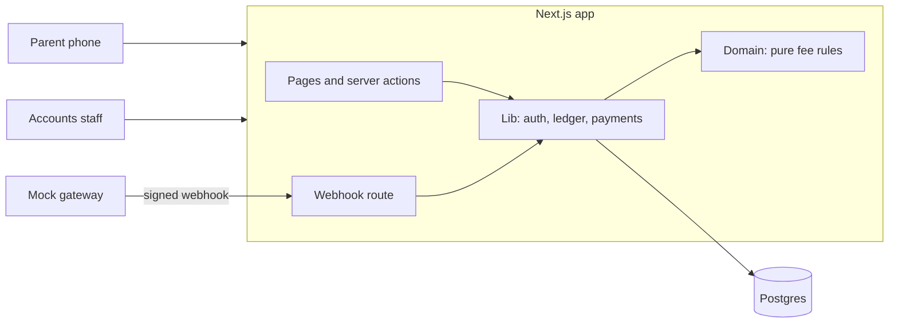
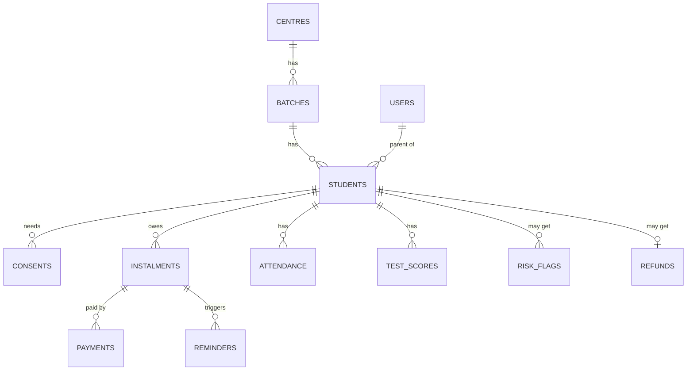
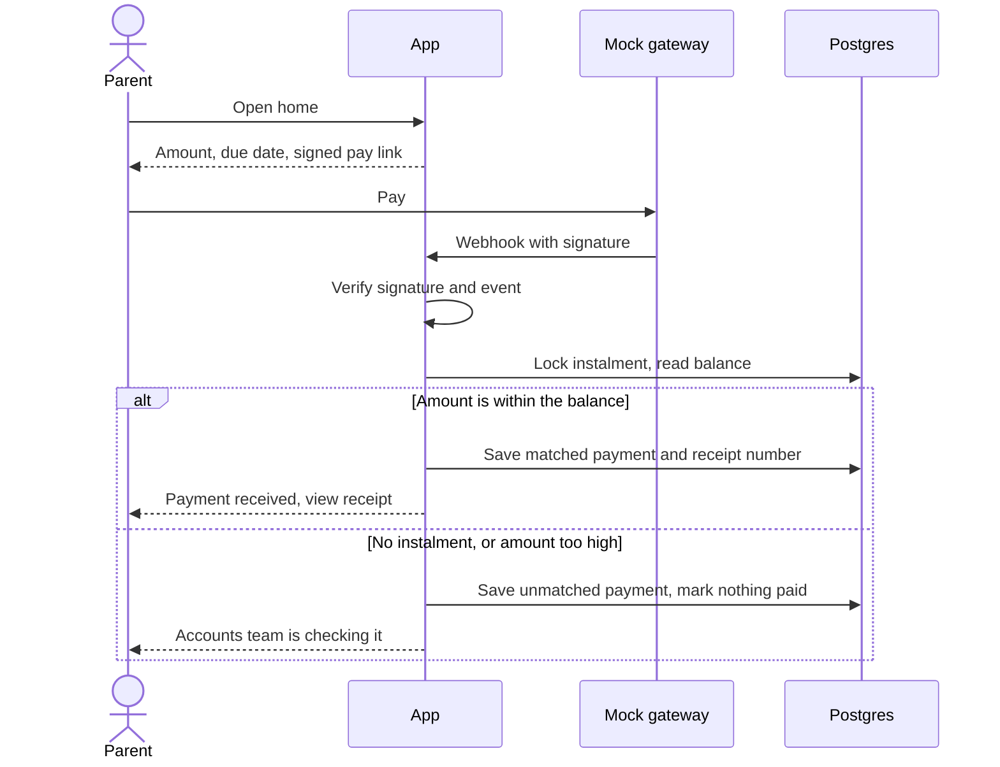
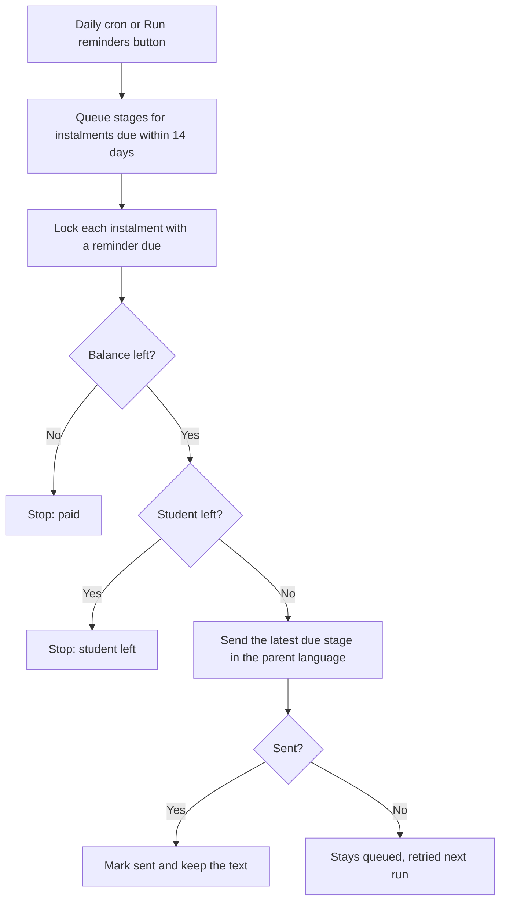

# Fee Tracker: Technical Design Document

**GitHub:** https://github.com/Siddhesh-source/coaching_institute
**Live app:** not deployed yet (see [deployment.md](../deployment.md))
**Status:** in progress, last updated 5 Nov 2026 (polish check done). Sections marked *Planned* are designed but not built.

---

## 1. Summary

Company A runs 4 coaching centres in Jaipur with 2,600 students. Dues live in Excel, staff phone parents, and refunds are worked out by hand. The brief puts the cost at ₹79.2 lakh a year.

Fee Tracker gives parents their dues on a phone in five seconds, in Hindi or English, with a pay button. It gives accounts staff one view of dues, reminders that stop on payment, and refunds that follow a written rule.

| Client success measure | What delivers it |
|---|---|
| Value over 60 days late: 12% to 6% | Automatic reminders, pay link in every message |
| Parent calls about dues: down 70% | Parent portal, dues readable in five seconds |
| Month-end reconciliation: 4 days to 1 | Automatic payment matching, Tally export |

## 2. Brief Against Status

| Brief requirement | Status | Notes |
|---|---|---|
| Sign-in with roles | Built | OTP for parent and accounts roles |
| Verifiable parental consent | Built | Recorded per child, blocks data until given |
| Hindi on parent screens | Built | Language chosen before sign-in |
| Parent dues and pay link | Built | One pay link per instalment, test gateway |
| Payment marks instalment paid | Built | Signed webhook only |
| Unmatched payments never mark paid | Built | Stored for the queue. Staff screen is planned |
| Receipts show GST | Built | Printable, Hindi and English |
| Realistic sample data | Built | 49 students, 4 centres, 9 batches |
| Pro-rata refund calculator | Built | Every working line, 10 day deadline, saved once per student |
| Published refund policy | Built | Public page in Hindi and English, printable |
| Fee ledger for staff | Built | Search, plan, discount, instalments, payments, balance, days overdue |
| Manual payments | Built | Same matching code as the webhook |
| Reminders that stop on payment | Built | Hindi and English, before, on and after, with a mock sender |
| Dues dashboard, ageing, Tally export | Built | Filters by centre and batch. CSV of receipts with GST split |
| AI dropout-risk flag | Built | Rule-based band with reasons. Call tasks only, with false-flag marking and rate |
| Bulk upload, parent attendance and scores | Optional | Outside the core build |

## 3. Architecture

One Next.js app holds the pages and the server logic, backed by one Postgres database. Payments, SMS and Tally are mocked as the brief allows.



**Why this shape:** one solo developer, 7 days, and a client who needs something to try. One codebase and one deploy means less to run, secure and explain. A separate API would add a second deploy and duplicated types, and nothing here needs them yet.

**Layers.** Dependencies point one way, from routes down to rules.

| Folder | Job | Rule |
|---|---|---|
| `src/app` | Pages, server actions, webhook | Thin. No business rules |
| `src/lib` | Sessions, ledger queries, payment recording | May use cookies and the database |
| `src/domain` | Fee, refund, OTP and matching rules | Pure functions, no framework or database |
| `src/db` | Schema, seed, sample data | |
| `src/i18n` | All user-facing text | English and Hindi share one type |

The money rules are the hard part of this brief, so they sit in `src/domain` where a test can run them in milliseconds.

| Part | Choice | Why |
|---|---|---|
| App | Next.js 16, React 19, TypeScript | Pages and server in one deploy |
| Database | Postgres 18 | Constraints and row locks protect money records |
| Queries | Drizzle | Plain SQL feel, typed, versioned migrations |
| Styling | Tailwind 4 | Design tokens live in one file |
| Validation | Zod | Checks outside data at the server boundary |
| Tests | Vitest | Unit tests, plus database tests on real Postgres |

## 4. Key Decisions

| Decision | Why | Rejected |
|---|---|---|
| Store money as whole paise | Sums never drift. Rounding happens once, on purpose | Decimals or floats |
| Dates as `YYYY-MM-DD` strings | A due date has no time zone, so it cannot shift by a day | Date objects |
| Paid amount is calculated from payments | One source of truth. Balance can never disagree with history | A stored `paid` column |
| One function marks instalments paid | `recordPayment` is the single place to audit | Updates spread across routes |
| Manual entry uses the same `recordPayment` | One matching rule for all money. A mismatch is refused inside the same lock, so it cannot race | A separate staff write path |
| Stop reminders in two places | The payment cancels queued reminders in the same step, and the job rechecks the balance at send time | Checking only when scheduling |
| Job and payments share one lock | A payment cannot slip in during a send, and two runs cannot send twice | A separate job lock |
| Only a signed webhook can record a gateway payment | The browser is never trusted to say it paid | Marking paid on the redirect |
| `gateway_ref` is unique | A repeated webhook changes nothing | Checking in code alone |
| Lock the instalment row while matching | Two payments cannot both use the same balance | Hoping they never collide |
| Database refuses a matched payment with no instalment | The rule holds even if the code has a bug | Code checks alone |
| Fixed demo date, `APP_TODAY=2026-11-02` | The brief's "23 days overdue" and "Due in 13 days" both point to this date | Real date, which would make the sample wrong |
| Pay links signed and free of student data | Safe to send in a message to a minor's family | Links needing sign-in |
| Role read from the database per request | A role change applies at once | Role stored in the cookie |
| Separate database for tests | Tests can wipe tables without touching demo data | Sharing one database |

## 5. Data Model

13 tables, 5 migrations. The core of it:



`otp_codes` stands alone, keyed by phone number.

Rules the database itself enforces:

- `payments.gateway_ref` and `receipt_no` are unique.
- A payment is `matched` only if it has an instalment, and the reverse.
- Amounts must be positive, discounts cannot exceed the plan, and attendance and scores stay in range.
- A student can have only one refund, and a reminder stage can exist only once per instalment.
- `risk_flags` has no link to fees or messages, so the flag has no route to a fee action.

## 6. Main Flows

### Sign-in and consent

1. The parent picks a language, then enters a mobile number.
2. An OTP is created and stored only as a hash. In demo mode it appears on screen, because SMS is mocked.
3. Unknown numbers get the same response, so the form cannot reveal who is registered.
4. The right code starts a signed, httpOnly session cookie.
5. Parents see the consent notice once. No student data loads until consent exists for every child.

### Payment



A double click sends the same reference, so the second one changes nothing. Tests prove this with six identical events arriving at once.

### Manual payment

Accounts staff record cash, UPI, cheque and bank payments from the student's ledger.

1. Staff pick the instalment, then enter the amount, method, reference and date.
2. The server checks the role, the input, and that the instalment belongs to this student.
3. `recordPayment` applies the same matching as the webhook.
4. Gateway money that does not match has really arrived, so it is queued. A manual entry that does not match is a typing mistake, so it is refused and nothing is saved.
5. Each payment stores the method, the reference and who entered it. The parent's balance updates at once.

### Refund

```
fee used = net fee x days used / term days     (both end dates count, rounded to the rupee)
refund   = amount paid - fee used              (never below zero)
due by   = exit date + 10 days
```

**Worked example:** Ishita Sharma, ₹1,20,000 plan, ₹45,000 paid, leaves 12 Oct 2026.
Fee used is ₹1,20,000 × 104 ÷ 365 = ₹34,192. Refund is **₹10,808**, due by 22 Oct 2026.

Tests also cover discounts, exit before term, exit after term, and a parent who paid less than the fee used.

**Screen.** Staff open it from the ledger and pick an exit date. The server shows every working line, the result and the deadline. A future date is a preview only, so the exit-after-term case can be checked before it happens.

**Saving** runs in one transaction:

1. Lock the student's instalments, the same lock `recordPayment` and the reminder job take. A payment in progress finishes first and is counted.
2. Work out the amount again from the database. Nothing about the amount comes from the form.
3. Store the refund with the net fee and amount paid, so the working stays true later.
4. Set the exit date and stop every queued reminder with the reason `student-left`.

**After saving,** the fee account is closed, because a later payment would make the saved refund wrong. Parents see the refund and no pay buttons. Old pay links stop working. Gateway money that still arrives goes to the unmatched queue, and manual payments are refused. The policy lives at `/refund-policy`, with no sign-in, and its example is worked through the real rule.

### Dues dashboard and Tally export

Staff land here after sign-in. Every figure is worked out on each page load from instalments and matched payments, by pure functions in `src/domain/dues.ts`. Nothing is stored or typed in.

| Figure | Meaning |
|---|---|
| Billed | Every instalment for the term |
| Collected | Matched payments only |
| Outstanding | All unpaid, including instalments not yet due |
| Overdue | The part of outstanding past its due date |
| Ageing | Overdue split by days late: up to 30, 31 to 60, over 60 |

Billed always equals collected plus outstanding, and the buckets always add up to overdue. Tests hold both true. A student with two late instalments can appear in two buckets, so bucket student counts can add up to more than the number of students.

Students who have left are not counted, because their fee account is closed. The page says how many were left out. The batch filter works by name, because the same batch name runs at several centres. The table keeps one row per batch at each centre.

**Tally export (assumed format).** The brief names no format, and Tally has no single standard CSV, so these columns are a proposal to map in Company A's import tool. It needs checking against their Tally setup before real use.

| Column | Example | Notes |
|---|---|---|
| Voucher Date | 05-10-2026 | Day first |
| Voucher Type | Receipt | Always Receipt |
| Voucher Number | RCT-000123 | The receipt number |
| Centre, Batch | Centre 1, JEE 2027 Evening | |
| Student ID | STU-0587 | No student name, because the ID is enough and most students are minors |
| Narration | Instalment 2, STU-0587 | |
| Debit Ledger | Bank | Cash for cash, Bank for everything else |
| Reference | UPI123 | Staff reference, or the gateway reference |
| Course Fee, CGST, SGST | 12711.86, 1144.07, 1144.07 | The fee before tax and the 9% + 9% split |
| Total | 15000.00 | The three parts always add up to this |

The file holds matched receipts in the chosen dates, within the chosen centre and batch. It includes students who have since left, because that money was received. Unmatched payments stay out until staff resolve them. Text that could run as a spreadsheet formula is made safe, since staff type the reference. The route checks the role and the dates first.

### Reminders



- **Stages:** 7 and 1 days before, on the due date, and 3 and 7 days after.
- **Stopping:** a full payment stops queued reminders in the same database step. The job also rechecks the balance at send time.
- **Part payments:** reminders continue, for the amount still left.
- **Missed days:** only the latest stage goes out, and older ones are marked replaced.
- **Failures:** a failed send stays queued and is retried on the next run.
- **Trigger:** a daily route protected by a secret, or the staff button. Both run the same job.

## 7. AI and Automation

| Automation | Status | When it is wrong or unsure |
|---|---|---|
| Payment matching | Built | Unmatched payments go to a queue and mark nothing paid |
| Reminders | Built | Balance rechecked at send time. Failed sends are retried |
| Dropout-risk flag | Built | Creates a call task only. Counsellors mark false flags. Too little data creates no task |

**Dropout-risk flag.** It runs daily from a protected route or a staff button, and reads missed instalments, attendance and test scores.

- **Method:** transparent points in `src/domain/risk.ts`, not a trained model. There is no real dropout history to train on, and a counsellor must be able to see why a student was flagged. So this is a rule-based flag in the place the brief calls AI. The review data it collects is what a trained model would need later.
- **Attendance:** the last 4 weeks against earlier weeks. A fall of 15 points scores 1, and 30 points scores 2.
- **Tests:** the last 2 tests against earlier tests. A fall of 10 points scores 1, and 20 points scores 2.
- **Missed instalments:** 1 overdue scores 1, and 2 or more scores 2.
- **Bands:** 2 points is watch and 4 is high, but only with an attendance or test sign. Late fees alone never flag anyone, however many, because reminders handle money and being short of money is not a sign of leaving.
- **Output:** a band with plain reasons, such as "Attendance fell from 83% to 42%". Never a score like 72/100, because a precise number would overstate what the data can show. Reasons are stored as facts and worded on screen in either language.
- **Unsure:** under 6 weeks of attendance, under 4 tests, or no fee plan gives "not enough data". The ledger says so and no task is created.

**When it is wrong.** The job writes to one table, `risk_flags`, which has no link to fees or messages. A test takes a full copy of instalments, payments, reminders, refunds, students, consents and users, runs the job and a review, and confirms nothing changed. Parents never see a flag. Counsellors mark each task "called" or "false flag", a false flag needs a note, and the screen shows the false-flag rate from real reviews. The rate is shown rather than fed back automatically, so a person decides when to change the thresholds.

**Repeat flags.** A student has at most one open task, enforced by a database index, and the job refreshes its reasons as data changes. After a review the job leaves that student alone for 30 days. Students who have left are skipped, and their open tasks drop off the list.

The thresholds were set by judgement against sample data I wrote myself, so passing here shows the logic works, not that it predicts dropouts. In the sample it flags exactly the three students built to trigger it, says Manav has too little data, and leaves Ishita alone despite her late fee.

## 8. Security and Compliance

| Requirement | How it is met |
|---|---|
| No secrets in the repo | `.env` is ignored by git. Only variable names are committed |
| Input validation | All checked on the server: Zod for webhook and gateway data, domain rules for phone numbers and OTP codes |
| Access control | `requireUser` and `requireParent` guard protected pages and actions. Parents cannot open staff pages |
| Parent isolation | Queries filter by owner. Another family's receipt returns "not found" |
| OTP abuse | Hashed, 5 minute expiry, 5 tries per code, 5 codes per 10 minutes |
| Parallel guessing | Attempts are counted in one statement. 12 parallel guesses stopped at exactly 5 |
| Session theft | httpOnly, SameSite=Lax, secure in production, signed, 7 day limit |
| Scheduled jobs | The reminders and risk routes refuse any call without the secret |
| Forged webhooks | Signature checked in constant time. Changed bodies are refused |
| Token reuse | Session and pay link tokens use separate signing keys |
| DPDP Act 2023 | Consent recorded per child with a notice version. A new version asks again |
| Coaching guidelines 2024 | Refund rule, 10 day deadline and published policy page built |
| GST on receipts | Taxable value, CGST and SGST shown. The parts always add up to the total |

## 9. UI and Design Decisions

The client asked for minimal design and that parents understand dues in five seconds. The direction is **trust and calm**. Full rules are in [DESIGN.md](../DESIGN.md).

| Screen or choice | Why it looks this way |
|---|---|
| Parent home | Only the name, amount, due date, pay button and one link. The test is five seconds |
| Pay button at the bottom | Within thumb reach on a phone |
| Overdue in amber, not red | It is a fact, not an emergency. Red is kept for real failures |
| Noto Sans | Has Hindi, the ₹ sign and equal-width digits, and is familiar on Android |
| One blue | If it is blue, it can be pressed |
| Language before sign-in | A Hindi reader should never have to read English to begin |
| Status always in words | Colour alone fails for some readers |
| Flat, no shadows | Light on low-end phones, and nothing without a purpose |

Fonts were tested, not assumed. Inter has no Hindi. Hind and Martel have uneven digits, which breaks ledger columns. Palanquin lacks the ₹ sign. All text passes contrast at 5.5:1 or better, up from 1.99:1 in the first mockups.

The 31 mockups are kept in `docs/mockups` as layout reference only. They contained invented claims and sample numbers that disagreed, listed in DESIGN.md.

## 10. Testing

220 tests pass, and CI runs lint, types, tests and a build on every push.

| Suite | Tests | Covers |
|---|---|---|
| Unit | 138 | Fee, refund, exit dates, OTP, GST, matching, ledger totals, reminder rules, dues and ageing, Tally format, risk bands and missing data, sessions, sample data |
| Database | 82 | Duplicates, races, part payments, unmatched cases, manual entry, reminder stages and stopping, saving refunds, payments after exit, dues filters, export dates, risk tasks and no side effects, webhook and cron security, student search |

Tests use the brief's own rows, so Aarav, Ishita and Mohit must produce exactly the brief's statuses. Main flows were also walked through in a real browser at 360px, in both languages.

A polish check then visited every screen at 360px in both languages, 67 views in all, measuring overflow, tap targets, field labels, headings and dead links. It also tried to reach another parent's child by changing the address, and looked for secrets in the full git history. Nothing leaked and no secrets were found.

Testing found real problems: forms that cleared every field after a validation error, a day count of `-0` on the due date, sample data that put every overdue student in NEET batches, a Hindi button overflowing its box, and an export that would have broken the production build.

## 11. Assumptions

The brief does not state these. Each one is my judgement.

| Topic | Assumption | Reason |
|---|---|---|
| Refund formula | Pure pro-rata by days, as in section 6 | The brief requires pro-rata but gives no written policy |
| Retained fee | None, confirmed by the owner | The brief mentions no registration fee |
| Refund saving | A future exit date is preview only. Saving is final, one per student, and keeps the figures used | Saving stops reminders, so it must mean the student has left |
| After a refund is saved | The fee account closes. Late gateway money is queued and manual payments are refused | A later payment would make the saved refund wrong |
| Unpaid fee used | Shown to staff, never collected automatically | The brief covers refunds, not recovering money from leavers |
| Refund deadline | Counts from the exit date, even if saved late | The brief says within 10 days of the student leaving |
| Academic term | 1 Jul 2026 to 30 Jun 2027 | No dates given. Instalments run to April |
| Instalment plans | ₹1,20,000 as 4 × ₹30,000 or 3 × ₹40,000 | Fits the brief's average fee and sample rows |
| Batch schedules | Due dates per programme, plus JEE 2028 and NEET 2028 | Only three due dates given |
| Part payments | Up to the balance is applied. More goes to the queue | The brief bars wrong amounts but its sample has part payments |
| Manual payments | Must fit the balance or are refused. Dates cannot be in the future | A typing mistake is not money that arrived |
| Parent home amount | Oldest unpaid instalment, other overdue amounts on one line | Pay links are per instalment |
| GST | 18% inside the fee, 9% CGST and 9% SGST, sample GSTIN | No rate or number given |
| Reminder days | 7 and 1 before, on the day, 3 and 7 after | The brief says before, on and after |
| Reminder delivery | Sent to the registered number whether or not the parent has used the portal, with the student's name | Reminders are the service itself, and a parent of two needs to know which child |
| Missed job days | Only the latest due stage goes out | A parent should not get several messages at once |
| Individual due dates | 6 sample students have their own due dates | So every stage falls on the fixed demo date |
| Ageing buckets | 0–30, 31–60, 60+ days | The success measure uses 60 days |
| Dues figures | Defined in section 6. Students who have left are not counted | The brief does not define them, and a closed account is not collectable |
| Tally export | One row per matched receipt, columns as in section 6 | The brief names no format |
| OTP limits | 5 minutes, 5 tries, 5 codes per 10 minutes | Not specified |
| Consent proof | OTP on the registered number, plus a stored record | Method not specified |
| Centre names | Centre 1 to Centre 4 | Not named |
| Counsellor | The accounts role handles call tasks | Only two roles in the core build |
| Risk method and thresholds | Points as in section 7 | No real dropout history to train on |
| Late fees alone | Never flag a student | Reminders handle money, and it is not a sign of leaving |
| Too little data | Under 6 weeks of attendance, under 4 tests, or no fee plan | The brief does not say how much is enough |
| Repeat flags | One open task per student, then 30 days after a review | A counsellor should not be asked again the next morning |
| False flag note | Required | The reason helps tune the rule |
| Sample data | All records beyond the 3 brief rows are invented | The brief asks for created sample data |

## 12. Limits, Cuts and Next Steps

**Known limits**

- Consent proves control of the registered phone, not legal guardianship. A real rollout needs a stronger check.
- Consent withdrawal goes through the centre's office. There is no in-app button.
- A saved manual payment cannot be edited or reversed yet. That needs a reversal entry, not a delete.
- Every accounts user can see all centres. There is no per-centre access yet.
- Reminders end after the 7 days after stage. A long-overdue account gets no further messages, so it needs staff follow-up.
- Pay links are about 230 characters. Real SMS needs a short link service.
- The job holds the instalment lock while sending. That is fine for a mock, but a real provider should be called with a timeout.
- OTP limits are per phone number, with no limit per IP address.
- Signing out clears the cookie on that device. It does not cancel a copied session token.
- Hindi text needs review by a native speaker before real use. Its layout has been checked, its wording has not.
- Screen behaviour such as forms keeping their values is checked in a browser, not by automated tests. Adding component tests would need a new dependency.
- The error page and loading placeholders were reviewed in code, not forced in a browser.
- The mock gateway is available only when `DEMO_MODE=true`. A real gateway needs its own webhook format.
- A saved refund cannot be edited or reversed, so a wrong exit date needs a database fix. It needs a reversal entry, as manual payments do.
- The app works out a refund but does not pay it. There is no "refund paid" step, and no list of refunds across students, so staff track the deadline from each ledger.
- The refund policy wording is a sample built on assumed rules. Company A must confirm it before real use.
- The Tally columns are assumed, and refunds are not exported. The file needs a trial import before real use.
- Receipt and export dates use UTC. A real payment just after midnight in India would show the day before, which matters at month end. The demo is not affected.
- The risk thresholds are judgement, tested only on invented data. They need checking against real dropouts before anyone relies on them.
- A student who stops being recorded altogether looks steady, because the flag reads the records it has. It does not notice that attendance has gone missing.
- Call tasks can be seen by every accounts user, and a closed task cannot be reopened.
- The dashboard shows what is late now. It does not yet track the brief's measure, the share of instalment value that arrives over 60 days late, which needs paid-late history too.

**Cut from the core build:** bulk upload, parent attendance and test score pages, audit log.

**Next, in order:** deployment and the submission files.
