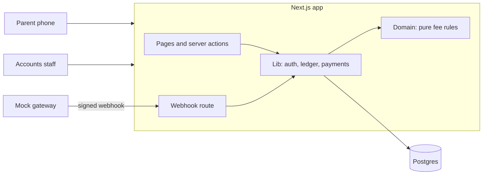
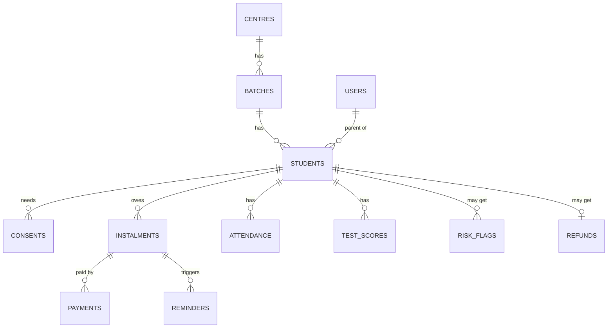
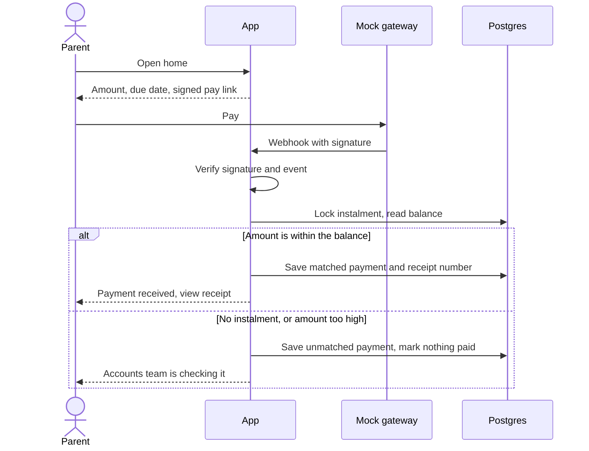

# Fee Tracker: Technical Design Document

**GitHub:** https://github.com/Siddhesh-source/coaching_institute
**Live app:** not deployed yet (see [deployment.md](../deployment.md))
**Status:** in progress, last updated 5 Nov 2026 (staff ledger added). Sections marked *Planned* are designed but not built.

---

## 1. Summary

Company A runs 4 coaching centres in Jaipur with 2,600 students. Dues live in Excel, staff phone parents, and refunds are worked out by hand. The brief puts the cost at ₹79.2 lakh a year.

Fee Tracker gives parents their dues on a phone in five seconds, in Hindi or English, with a pay button. It gives accounts staff one view of dues, reminders that stop on payment, and refunds that follow a written rule.

| Client success measure | What delivers it |
|---|---|
| Value over 60 days late: 12% to 6% | Automatic reminders, pay link in every message |
| Parent calls about dues: down 70% | Parent portal, dues readable in five seconds |
| Month-end reconciliation: 4 days to 1 | Automatic payment matching, Tally export |

## 2. Brief Against Status

| Brief requirement | Status | Notes |
|---|---|---|
| Sign-in with roles | Built | OTP for parent and accounts roles |
| Verifiable parental consent | Built | Recorded per child, blocks data until given |
| Hindi on parent screens | Built | Language chosen before sign-in |
| Parent dues and pay link | Built | One pay link per instalment, test gateway |
| Payment marks instalment paid | Built | Signed webhook only |
| Unmatched payments never mark paid | Built | Stored for the queue. Staff screen is planned |
| Receipts show GST | Built | Printable, Hindi and English |
| Realistic sample data | Built | 43 students, 4 centres, 9 batches |
| Pro-rata refund rules | Rules built | Tested logic. Screen is planned |
| Fee ledger for staff | Built | Search, plan, discount, instalments, payments, balance, days overdue |
| Manual payments | Built | Same matching code as the webhook |
| Reminders that stop on payment | Planned | Table ready |
| Dues dashboard, ageing, Tally export | Planned | |
| AI dropout-risk flag | Planned | Input data seeded, including test cases |
| Bulk upload, parent attendance and scores | Optional | Outside the core build |

## 3. Architecture

One Next.js app holds the pages and the server logic, backed by one Postgres database. Payments, SMS and Tally are mocked as the brief allows.



**Why this shape:** one solo developer, 7 days, and a client who needs something to try. One codebase and one deploy means less to run, secure and explain. A separate API would add a second deploy and duplicated types, and nothing here needs them yet.

**Layers.** Dependencies point one way, from routes down to rules.

| Folder | Job | Rule |
|---|---|---|
| `src/app` | Pages, server actions, webhook | Thin. No business rules |
| `src/lib` | Sessions, ledger queries, payment recording | May use cookies and the database |
| `src/domain` | Fee, refund, OTP and matching rules | Pure functions, no framework or database |
| `src/db` | Schema, seed, sample data | |
| `src/i18n` | All user-facing text | English and Hindi share one type |

The money rules are the hard part of this brief, so they sit in `src/domain` where a test can run them in milliseconds.

| Part | Choice | Why |
|---|---|---|
| App | Next.js 16, React 19, TypeScript | Pages and server in one deploy |
| Database | Postgres 18 | Constraints and row locks protect money records |
| Queries | Drizzle | Plain SQL feel, typed, versioned migrations |
| Styling | Tailwind 4 | Design tokens live in one file |
| Validation | Zod | Checks outside data at the server boundary |
| Tests | Vitest | Unit tests, plus database tests on real Postgres |

## 4. Key Decisions

| Decision | Why | Rejected |
|---|---|---|
| Store money as whole paise | Sums never drift. Rounding happens once, on purpose | Decimals or floats |
| Dates as `YYYY-MM-DD` strings | A due date has no time zone, so it cannot shift by a day | Date objects |
| Paid amount is calculated from payments | One source of truth. Balance can never disagree with history | A stored `paid` column |
| One function marks instalments paid | `recordPayment` is the single place to audit | Updates spread across routes |
| Manual entry uses the same `recordPayment` | One matching rule for all money. A mismatch is refused inside the same lock, so it cannot race | A separate staff write path |
| Only a signed webhook can record a gateway payment | The browser is never trusted to say it paid | Marking paid on the redirect |
| `gateway_ref` is unique | A repeated webhook changes nothing | Checking in code alone |
| Lock the instalment row while matching | Two payments cannot both use the same balance | Hoping they never collide |
| Database refuses a matched payment with no instalment | The rule holds even if the code has a bug | Code checks alone |
| Fixed demo date, `APP_TODAY=2026-11-02` | The brief's "23 days overdue" and "Due in 13 days" both point to this date | Real date, which would make the sample wrong |
| Pay links signed and free of student data | Safe to send in a message to a minor's family | Links needing sign-in |
| Role read from the database per request | A role change applies at once | Role stored in the cookie |
| Separate database for tests | Tests can wipe tables without touching demo data | Sharing one database |

## 5. Data Model

13 tables, 4 migrations. The core of it:



`otp_codes` stands alone, keyed by phone number.

Rules the database itself enforces:

- `payments.gateway_ref` and `receipt_no` are unique.
- A payment is `matched` only if it has an instalment, and the reverse.
- Amounts must be positive, discounts cannot exceed the plan, and attendance and scores stay in range.
- A student can have only one refund, and a reminder stage can exist only once per instalment.
- `risk_flags` has no link to fees or messages, so the flag has no route to a fee action.

## 6. Main Flows

### Sign-in and consent

1. The parent picks a language, then enters a mobile number.
2. An OTP is created and stored only as a hash. In demo mode it appears on screen, because SMS is mocked.
3. Unknown numbers get the same response, so the form cannot reveal who is registered.
4. The right code starts a signed, httpOnly session cookie.
5. Parents see the consent notice once. No student data loads until consent exists for every child.

### Payment



A double click sends the same reference, so the second one changes nothing. Tests prove this with six identical events arriving at once.

### Manual payment

Accounts staff record cash, UPI, cheque and bank payments from the student's ledger.

1. Staff pick the instalment, then enter the amount, method, reference and date.
2. The server checks the role, the input, and that the instalment belongs to this student.
3. `recordPayment` applies the same matching as the webhook.
4. Gateway money that does not match has really arrived, so it is queued. A manual entry that does not match is a typing mistake, so it is refused and nothing is saved.
5. Each payment stores the method, the reference and who entered it. The parent's balance updates at once.

### Refund (rules built, screen planned)

```
fee used = net fee x days used / term days     (both end dates count, rounded to the rupee)
refund   = amount paid - fee used              (never below zero)
due by   = exit date + 10 days
```

**Worked example:** Ishita Sharma, ₹1,20,000 plan, ₹45,000 paid, leaves 12 Oct 2026.
Fee used is ₹1,20,000 × 104 ÷ 365 = ₹34,192. Refund is **₹10,808**, due by 22 Oct 2026.

Tests also cover discounts, exit before term, exit after term, and a parent who paid less than the fee used.

### Reminders (planned)

A daily job finds instalments at 7 and 1 days before, on the day, and 3 and 7 days after. It sends through a mock sender in the parent's language, with a pay link. The balance is checked again at send time, so a payment made a minute earlier still stops the message.

## 7. AI and Automation

| Automation | Status | When it is wrong or unsure |
|---|---|---|
| Payment matching | Built | Unmatched payments go to a queue and mark nothing paid |
| Reminders | Planned | Balance rechecked at send time |
| Dropout-risk flag | Planned | Creates a call task only. Counsellors mark false flags |

**Dropout-risk flag (planned design).** It combines missed instalments, attendance trend and test trend into a band: none, watch or high.

- **Method:** a transparent weighted score. There is no real outcome data to train a model on, and a counsellor must be able to see why a student was flagged.
- **Output:** a band with plain reasons, not a score like 72/100. A precise number would overstate what the data can show.
- **Unsure:** with too little data it says so and creates no task.
- **Limits by design:** it never triggers a fee action or a parent message.
- **Learning from mistakes:** false flags are counted, so the rate is visible.

The seed already holds three students who should trigger the flag, one with too little data, and Ishita, who has a late fee but steady attendance and scores, so one late fee alone should not flag her.

## 8. Security and Compliance

| Requirement | How it is met |
|---|---|
| No secrets in the repo | `.env` is ignored by git. Only variable names are committed |
| Input validation | All checked on the server: Zod for webhook and gateway data, domain rules for phone numbers and OTP codes |
| Access control | `requireUser` and `requireParent` guard protected pages and actions. Parents cannot open staff pages |
| Parent isolation | Queries filter by owner. Another family's receipt returns "not found" |
| OTP abuse | Hashed, 5 minute expiry, 5 tries per code, 5 codes per 10 minutes |
| Parallel guessing | Attempts are counted in one statement. 12 parallel guesses stopped at exactly 5 |
| Session theft | httpOnly, SameSite=Lax, secure in production, signed, 7 day limit |
| Forged webhooks | Signature checked in constant time. Changed bodies are refused |
| Token reuse | Session and pay link tokens use separate signing keys |
| DPDP Act 2023 | Consent recorded per child with a notice version. A new version asks again |
| Coaching guidelines 2024 | Refund rule and 10 day deadline built. Published policy page planned |
| GST on receipts | Taxable value, CGST and SGST shown. The parts always add up to the total |

## 9. UI and Design Decisions

The client asked for minimal design and that parents understand dues in five seconds. The direction is **trust and calm**. Full rules are in [DESIGN.md](../DESIGN.md).

| Screen or choice | Why it looks this way |
|---|---|
| Parent home | Only the name, amount, due date, pay button and one link. The test is five seconds |
| Pay button at the bottom | Within thumb reach on a phone |
| Overdue in amber, not red | It is a fact, not an emergency. Red is kept for real failures |
| Noto Sans | Has Hindi, the ₹ sign and equal-width digits, and is familiar on Android |
| One blue | If it is blue, it can be pressed |
| Language before sign-in | A Hindi reader should never have to read English to begin |
| Status always in words | Colour alone fails for some readers |
| Flat, no shadows | Light on low-end phones, and nothing without a purpose |

Fonts were tested, not assumed. Inter has no Hindi. Hind and Martel have uneven digits, which breaks ledger columns. Palanquin lacks the ₹ sign. All text passes contrast at 5.5:1 or better, up from 1.99:1 in the first mockups.

The 31 mockups are kept in `docs/mockups` as layout reference only. They contained invented claims and sample numbers that disagreed, listed in DESIGN.md.

## 10. Testing

103 tests pass, and CI runs lint, types, tests and a build on every push.

| Suite | Tests | Covers |
|---|---|---|
| Unit | 76 | Fee, refund, OTP, GST, matching, ledger totals, sessions, sample data |
| Database | 27 | Duplicates, races, part payments, unmatched cases, manual entry, webhook signatures, student search |

Tests use the brief's own rows, so Aarav, Ishita and Mohit must produce exactly the brief's statuses. Main flows were also walked through in a real browser at 360px, in both languages.

Testing found real problems: a day count of `-0` on the due date, sample data that put every overdue student in NEET batches, a Hindi button overflowing its box, and an export that would have broken the production build.

## 11. Assumptions

The brief does not state these. Each one is my judgement.

| Topic | Assumption | Reason |
|---|---|---|
| Refund formula | Pure pro-rata by days, as in section 6 | The brief requires pro-rata but gives no written policy |
| Retained fee | None | The brief mentions no registration fee |
| Academic term | 1 Jul 2026 to 30 Jun 2027 | No dates given. Instalments run to April |
| Instalment plans | ₹1,20,000 as 4 × ₹30,000 or 3 × ₹40,000 | Fits the brief's average fee and sample rows |
| Batch schedules | Due dates per programme, plus JEE 2028 and NEET 2028 | Only three due dates given |
| Part payments | Up to the balance is applied. More goes to the queue | The brief bars wrong amounts but its sample has part payments |
| Manual payments | Must fit the balance or are refused. Dates cannot be in the future | A typing mistake is not money that arrived |
| Parent home amount | Oldest unpaid instalment, other overdue amounts on one line | Pay links are per instalment |
| GST | 18% inside the fee, 9% CGST and 9% SGST, sample GSTIN | No rate or number given |
| Reminder days | 7 and 1 before, on the day, 3 and 7 after | The brief says before, on and after |
| Ageing buckets | 0–30, 31–60, 60+ days | The success measure uses 60 days |
| OTP limits | 5 minutes, 5 tries, 5 codes per 10 minutes | Not specified |
| Consent proof | OTP on the registered number, plus a stored record | Method not specified |
| Centre names | Centre 1 to Centre 4 | Not named |
| Counsellor | The accounts role handles call tasks | Only two roles in the core build |
| Sample data | All records beyond the 3 brief rows are invented | The brief asks for created sample data |

## 12. Limits, Cuts and Next Steps

**Known limits**

- Consent proves control of the registered phone, not legal guardianship. A real rollout needs a stronger check.
- Consent withdrawal goes through the centre's office. There is no in-app button.
- A saved manual payment cannot be edited or reversed yet. That needs a reversal entry, not a delete.
- Every accounts user can see all centres. There is no per-centre access yet.
- OTP limits are per phone number, with no limit per IP address.
- Signing out clears the cookie on that device. It does not cancel a copied session token.
- Hindi text needs review by a native speaker before real use.
- The mock gateway is available only when `DEMO_MODE=true`. A real gateway needs its own webhook format.
- The phone field clears after a validation error.

**Cut from the core build:** bulk upload, parent attendance and test score pages, audit log.

**Next, in order:** reminders, refund screen and policy page, dues dashboard with Tally export, risk flag, full polish pass, deployment.
